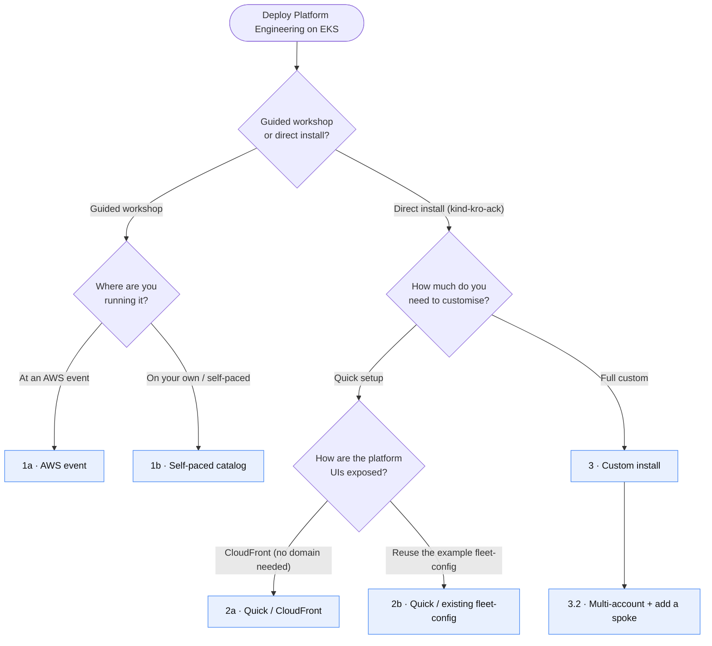

# Install guide — choose your path

Platform Engineering on Amazon EKS can be deployed in several ways. This guide is a
**decision diagram**: pick the branch that matches your situation and follow the one
procedure it points to. Every leaf of the diagram maps to a dedicated, step‑by‑step
procedure (exact `config.local.yaml` + guard‑rails).

> **Workshop vs. direct install.** If you are here for the **guided workshop** (an AWS
> event, or self‑paced), follow the hosted workshop — there is nothing to re‑document.
> If you want to install the platform **directly** into your own AWS account with the
> `kind-kro-ack` cluster provider (no Workshop Studio CloudFormation), this guide is the
> one you want.

## Choose your path

**Go to:** [1a · AWS event](https://awsworkshop.io/eks/platform) ·
[1b · Self-paced](https://catalog.workshops.aws/platform-engineering-on-eks/en-US/00-start-workshop/02-self-paced) ·
[2a · CloudFront](quick-cloudfront.md) ·
[2b · Existing fleet-config](quick-existing-fleet.md) ·
[3 · Custom install](custom-install.md) ·
[3.2 · Multi-account](custom-multi-account.md)

> **Note on the links.** GitHub's Mermaid renderer ignores `click` links in diagrams, so use the
> line above (other Mermaid renderers make the leaves clickable).

Prerequisites, cost, deleting a spoke, restricting the ALB by source IP and documenting your
deployment are not path choices: they are listed under
[Advanced operations](#advanced-operations-all-modes).

## Procedures

| # | Leaf | What it covers | Go to |
|---|------|----------------|-------|
| 1a | AWS event | The guided workshop, run at an AWS‑led event (access code, account provided) | [Workshop — AWS event](https://awsworkshop.io/eks/platform) *(external)* · upcoming events: [AWS Events](https://aws.amazon.com/events/) |
| 1b | Self‑paced | The same workshop, run on your own account | [Workshop — self‑paced](https://catalog.workshops.aws/platform-engineering-on-eks/en-US/00-start-workshop/02-self-paced) *(external)* |
| 2a | Quick / CloudFront | Direct install exposed behind a free `*.cloudfront.net` host — **no domain, no ACM cert needed** | [quick-cloudfront.md](quick-cloudfront.md) |
| 2b | Quick / existing fleet‑config | Direct install that reuses the public example fleet repo (`fleet-config-peeks-example`) — **zero‑fork, zero‑PAT** | [quick-existing-fleet.md](quick-existing-fleet.md) |
| 3 | Custom install | Your own domain/cert and fleet repo: annotated `config.local.yaml`, install, verify (after the [prerequisites](prerequisites.md)) | [custom-install.md](custom-install.md) |
| 3.2 | Multi‑account + add a spoke | Configure cross‑account CARM and create a spoke in another account | [custom-multi-account.md](custom-multi-account.md) |

## Choose your fleet-config

The fleet repo (`fleetRepo` in `config.local.yaml`) holds the spoke declarations ArgoCD reconciles.
Pick one of three options:

| Option | When | What to do |
|---|---|---|
| **(a) Upstream example, unchanged** | Quickest start; spokes `dev`/`prod` in the hub's account; you accept that the declarations (names, regions, CIDRs — no account IDs) are public | Point `fleetRepo.url` at [`fleet-config-peeks-example`](https://github.com/allamand/fleet-config-peeks-example) — no fork, no token. Procedure: [2b](quick-existing-fleet.md) |
| **(b) Fork of the example** | You want to add/change spokes or edit enabled addons | [Fork the example repo](https://github.com/allamand/fleet-config-peeks-example/fork) and set `fleetRepo.url` to your fork. A **public** fork is read anonymously (no PAT). A **private** fork, or the generative `spokes:*` flows that push to the repo, need a PAT — see below |
| **(c) Your own git provider** | Private GitHub/GitLab repo, or a layout you control | Follow [custom-install.md — fleet repo](custom-install.md#1-fleet-repo-prerequisite--fork-or-your-own-git-provider) and [git token](custom-install.md#2-git-token-only-for-a-private-fleet-repo-or-generative-spoke-push) |

Config keys: `fleetRepo.{url,revision,basepath}`, each falling back to `repo.*` when omitted
([example block](custom-install.md#1-fleet-repo-prerequisite--fork-or-your-own-git-provider)).

**PAT (private fork, option c, or `spokes:*` push).** There is no token key in `config.local.yaml`:
the PAT goes into AWS Secrets Manager and an ArgoCD `repository` Secret `argocd/fleet-config-repo`.
Minimal scopes and manifests:
[custom-install.md, section 2](custom-install.md#2-git-token-only-for-a-private-fleet-repo-or-generative-spoke-push).

## Advanced operations (all modes)

These pages are not install paths. Each one states which modes it applies to.

| Topic | Modes | What it covers | Go to |
|---|---|---|---|
| Prerequisites | Direct installs (the workshop IDE is pre-provisioned) | Host tools and versions, AWS account prerequisites (Identity Center, ACM, Route53) | [prerequisites.md](prerequisites.md) |
| Solution cost | All (nothing to pay at an AWS event) | What the solution creates, how to estimate, track, reduce and stop the cost | [cost.md](cost.md) |
| Delete a spoke | All (the workshop also has ready-made tasks) | Cleanly tear down one spoke (spec → prune → sweep) | [delete-spoke.md](delete-spoke.md) |
| Restrict the ALB by source IP | Direct install with your own writable fleet repo (not CloudFront mode, where the ALB is internal) | Set, change or remove the source‑IP allowlist of the shared `platform` ALB (all hub UIs), plus closing Langfuse self‑registration | [alb-ip-allowlist.md](alb-ip-allowlist.md) |
| Document your deployment | Any mode where you keep your own fork | Record your deployment choices in your fork's README, zero‑secret | [custom-install.md — section 5](custom-install.md#5-document-your-deployment) |

## How the paths relate

All three **direct‑install** paths run the same `task install` with the `kind-kro-ack`
cluster provider — an ephemeral local `kind` cluster bootstraps a self‑managed EKS **hub**,
which then becomes self‑managing through ArgoCD. They differ only in two independent choices:

1. **How the UIs are exposed** — set by the `insecure` key in `config.local.yaml`:
   - `insecure: true` → the ALB stays HTTP‑only and something upstream terminates TLS. The
     simplest case is **CloudFront** with a free `*.cloudfront.net` name → **path 2a**.
   - `insecure: false` → the ALB serves **HTTPS** with your own ACM certificate on your own
     Route53 domain → the **custom** path ([prerequisites](prerequisites.md) cover the domain/cert).
2. **Where the spoke declarations live** — a *fleet repo* (`fleetRepo.url`):
   - reuse the **public example** repo as‑is → **path 2b** (zero‑fork, zero‑PAT);
   - fork it or point at your own git provider → see [Choose your fleet-config](#choose-your-fleet-config).

The **custom** path (3.x) is the superset: it adds your own domain/cert, your own fleet
repo and cross‑account spokes. Day‑2 operations (delete a spoke, cost, ALB allowlist) are under
[Advanced operations](#advanced-operations-all-modes).

## Honest status of the direct path

- **Hub: works today.** A direct `kind-kro-ack` `task install` brings up a working hub.
- **Agentic platform (OAP): wired, not yet self-standing on the direct path.** When the
  `agenticRepo` block is set, its coordinates are mirrored into the hub cluster-secret annotations
  (`addons_repo_url` / `addons_repo_revision`) that the agent-platform appsets consume — but no
  appmod Taskfile yet applies OAP's `agent-platform-app.yaml`, so the direct `task install` does
  **not** stand the agentic platform up on its own today. Tracked in
  [#1157](https://github.com/aws-samples/appmod-blueprints/issues/1157) and
  [open-agentic-platform#98](https://github.com/awslabs/open-agentic-platform/issues/98).
- **Same‑account spokes:** covered by `global.spokeNames` (the fix that ships with
  [#1157](https://github.com/aws-samples/appmod-blueprints/issues/1157)) plus a fleet repo
  that declares them — see [quick-existing-fleet.md](quick-existing-fleet.md) and
  [custom-multi-account.md](custom-multi-account.md).
- **Cross‑account spokes:** declared through `configs/multi-acct/values.yaml` with an
  explicit account ID per spoke — see [custom-multi-account.md](custom-multi-account.md).

Each procedure states precisely what is verified and flags anything still to validate.
