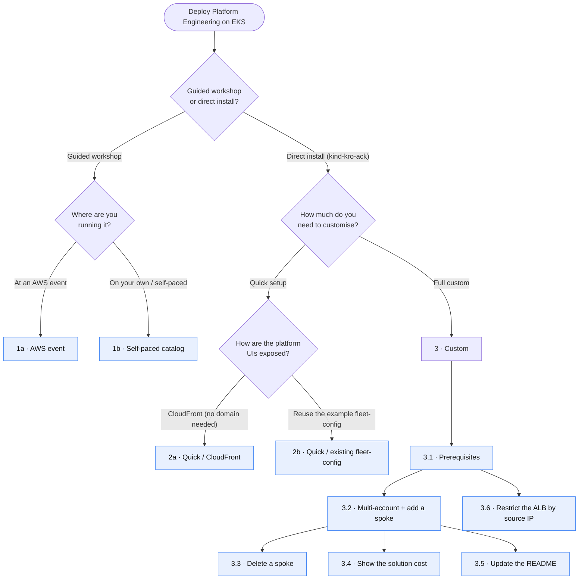

# Install guide — choose your path

Platform Engineering on Amazon EKS can be deployed in several ways. This guide is a
**decision diagram**: pick the branch that matches your situation and follow the one
procedure it points to. Every leaf of the diagram maps to a dedicated, step‑by‑step
procedure (prerequisites + exact `config.local.yaml` + guard‑rails).

> **Workshop vs. direct install.** If you are here for the **guided workshop** (an AWS
> event, or self‑paced), follow the hosted workshop — there is nothing to re‑document.
> If you want to install the platform **directly** into your own AWS account with the
> `kind-kro-ack` cluster provider (no Workshop Studio CloudFormation), this guide is the
> one you want.

## Choose your path

> **Note on the links.** GitHub's Mermaid renderer strips clickable links from diagram
> nodes for security, so the leaves above are **not** clickable. Use the table below —
> each numbered leaf maps to its procedure file.

## Procedures

| # | Leaf | What it covers | Go to |
|---|------|----------------|-------|
| 1a | AWS event | The guided workshop, run at an AWS‑led event | [awsworkshop.io/eks/platform](https://awsworkshop.io/eks/platform) *(external workshop)* |
| 1b | Self‑paced | The same workshop, run on your own account | [catalog.workshops.aws/platform-engineering-on-eks](https://catalog.workshops.aws/platform-engineering-on-eks/en-US) *(external workshop)* |
| 2a | Quick / CloudFront | Direct install exposed behind a free `*.cloudfront.net` host — **no domain, no ACM cert needed** | [quick-cloudfront.md](quick-cloudfront.md) |
| 2b | Quick / existing fleet‑config | Direct install that reuses the public example fleet repo (`fleet-config-peeks-example`) — **zero‑fork, zero‑PAT** | [quick-existing-fleet.md](quick-existing-fleet.md) |
| 3.1 | Prerequisites | Hosted zone, your own fleet repo (fork **or** custom git provider), git token | [custom-prerequisites.md](custom-prerequisites.md) |
| 3.2 | Multi‑account + add a spoke | Configure cross‑account CARM and create a spoke in another account | [custom-multi-account.md](custom-multi-account.md) |
| 3.3 | Delete a spoke | Cleanly tear down one spoke (overlay → prune → sweep) | [custom-delete-spoke.md](custom-delete-spoke.md) |
| 3.4 | Show the solution cost | Estimate / track the cost of hub + N spokes | [custom-cost.md](custom-cost.md) |
| 3.5 | Update the README | Keep your fork's README in sync with your deployment choices | [custom-update-readme.md](custom-update-readme.md) |
| 3.6 | Restrict the ALB by source IP | Set, change or remove the source‑IP allowlist of the shared `platform` ALB (all hub UIs), plus closing Langfuse self‑registration | [custom-alb-ip-allowlist.md](custom-alb-ip-allowlist.md) |

## How the paths relate

All three **direct‑install** paths run the same `task install` with the `kind-kro-ack`
cluster provider — an ephemeral local `kind` cluster bootstraps a self‑managed EKS **hub**,
which then becomes self‑managing through ArgoCD. They differ only in two independent choices:

1. **How the UIs are exposed** — set by the `insecure` key in `config.local.yaml`:
   - `insecure: true` → the ALB stays HTTP‑only and something upstream terminates TLS. The
     simplest case is **CloudFront** with a free `*.cloudfront.net` name → **path 2a**.
   - `insecure: false` → the ALB serves **HTTPS** with your own ACM certificate on your own
     Route53 domain → the **custom** path (3.1 prerequisites cover the domain/cert).
2. **Where the spoke declarations live** — a *fleet repo* (`fleetRepo.url`):
   - reuse the **public example** repo as‑is → **path 2b** (zero‑fork, zero‑PAT);
   - fork it or point at your own git provider → **custom** path (3.1).

The **custom** path (3.x) is the superset: it adds your own domain/cert, your own fleet
repo, cross‑account spokes, and the day‑2 operations (delete a spoke, see the cost).

## Honest status of the direct path

- **Hub: works today.** A direct `kind-kro-ack` `task install` brings up a working hub.
- **Agentic platform (OAP): wired, not yet self-standing on the direct path.** When the
  `agenticRepo` block is set, its coordinates are mirrored into the hub cluster-secret annotations
  (`addons_repo_url` / `addons_repo_revision`) that the agent-platform appsets consume — but no
  appmod Taskfile yet applies OAP's `agent-platform-app.yaml`, so the direct `task install` does
  **not** stand the agentic platform up on its own today. Tracked in
  [#1157](https://github.com/aws-samples/appmod-blueprints/issues/1157) and
  [open-agentic-platform#98](https://github.com/awslabs/open-agentic-platform/issues/98).
- **Same‑account spokes:** covered by `global.spokeNames` (the fix that ships with
  [#1157](https://github.com/aws-samples/appmod-blueprints/issues/1157)) plus a fleet repo
  that declares them — see [quick-existing-fleet.md](quick-existing-fleet.md) and
  [custom-multi-account.md](custom-multi-account.md).
- **Cross‑account spokes:** declared through `configs/multi-acct/values.yaml` with an
  explicit account ID per spoke — see [custom-multi-account.md](custom-multi-account.md).

Each procedure states precisely what is verified and flags anything still to validate.
